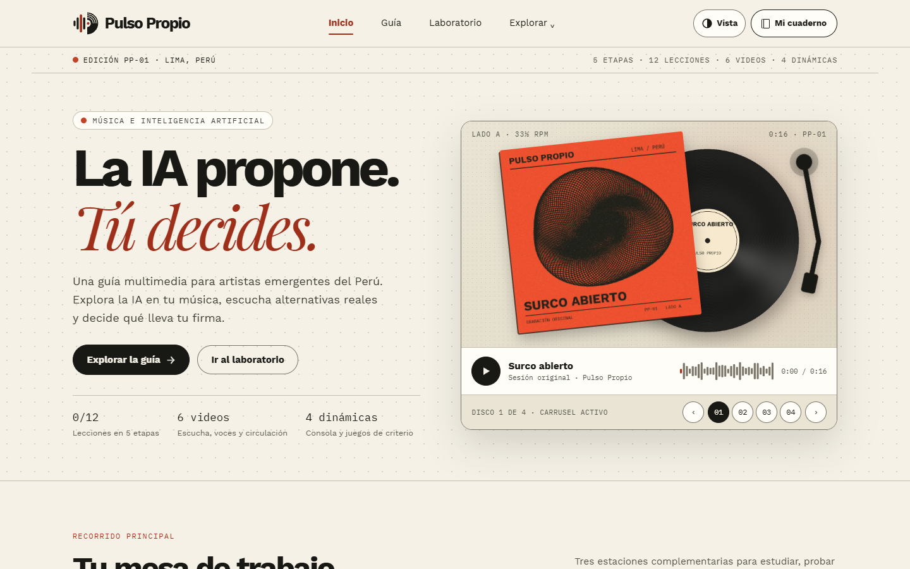
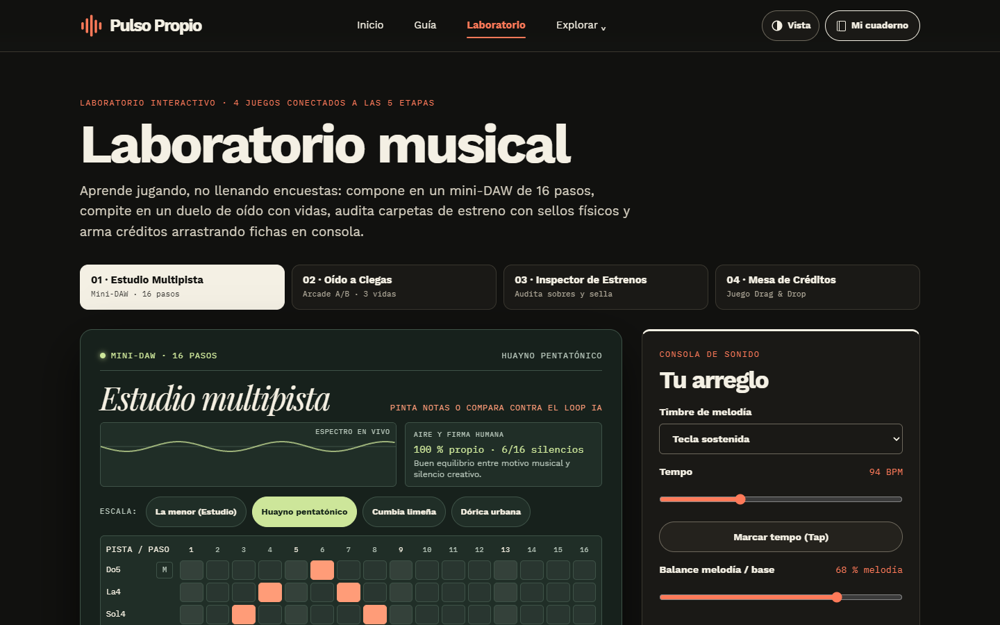
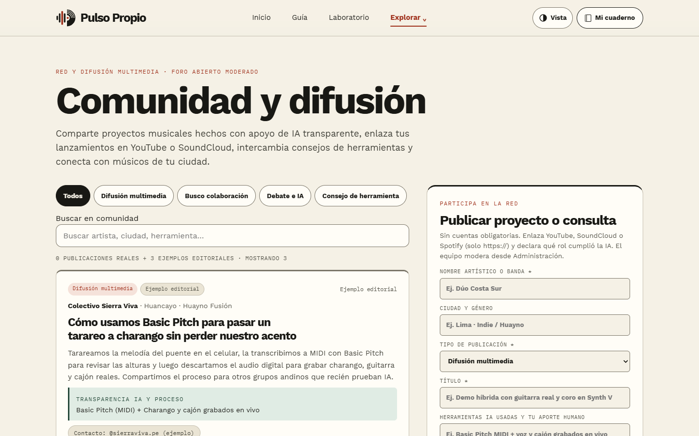

<div align="center">

<br>

<picture>
  <source media="(prefers-color-scheme: dark)" srcset="./public/assets/pulso-logo-dark.svg">
  <source media="(prefers-color-scheme: light)" srcset="./public/assets/pulso-logo-light.svg">
  
</picture>

<h3>La IA propone. <em>Tú decides.</em></h3>

<p>
  <strong>Guía práctica digital multimedia, laboratorio musical Web Audio y comunidad moderada</strong><br>
  para artistas emergentes del Perú que integran inteligencia artificial asistiva en sus canciones sin perder autoría ni transparencia.
</p>

<p>
  <a href="https://matadorrojo.pythonanywhere.com/">
    
  </a>
  
  
  
  
</p>

<p>
  <a href="#qué-incluye">Qué incluye</a> ·
  <a href="#laboratorio-de-5-estaciones">Laboratorio</a> ·
  <a href="#inicio-rápido">Inicio rápido</a> ·
  <a href="#despliegue-pythonanywhere-vs-github-pages">Despliegue</a> ·
  <a href="#arquitectura-y-librerías">Arquitectura</a> ·
  <a href="#verificación-y-calidad">Verificación</a>
</p>

<br>

<picture>
  <source media="(prefers-color-scheme: dark)" srcset="./docs/preview-estudio.png">
  <source media="(prefers-color-scheme: light)" srcset="./docs/preview-papel.png">
  
</picture>

<sub>Portada interactiva en modos <strong>Papel</strong> y <strong>Estudio</strong> (más tema <strong>AAA 21:1</strong> con acento amarillo). El carrusel rota automáticamente 4 discos originales cada 5 s y se congela al reproducir.</sub>

</div>

---

## Por qué existe Pulso Propio

Los informes internacionales recientes con músicos independientes (**Ditto Music, Sonarworks, LANDR y Deezer/UMG, 2025–2026**) muestran dos realidades claras:

- **Más del 70 %** de los artistas que adoptan IA la usan de forma **asistiva** —separación de *stems*, limpieza vocal, masterización y lluvia de ideas—, no para reemplazar su composición ni su voz.
- **Más del 80 %** de la audiencia exige **etiquetado transparente** cuando una canción incorpora IA.

**Pulso Propio** traduce esa realidad al contexto musical peruano (Indecopi, D.L. 822, Ley 28131, Art. 15 del Código Civil, APDAYC y DS 115-2025-PCM) en una plataforma local-first y sin cuentas obligatorias, creada en la **Universidad Peruana de Ciencias Aplicadas (UPC)** para *Nuevos Medios y Nuevas Tendencias*.

---

## Qué incluye

| Sección | Ruta | Contenido principal |
| :--- | :--- | :--- |
| **Inicio** | `#/` | Portada limpia con **carrusel de 4 vinilos originales** (*Surco abierto*, *Pulso andino*, *Aire limeño* y *Silencio final*), visualizador de audio en vivo y acceso directo a la mesa de trabajo. |
| **Guía multimedia** | `#/guia` | **5 etapas reales** (*Idear, Componer, Producir, Proteger, Publicar*) y **12 lecciones** con bloque de realidad **+70 % IA asistiva**, cuadros *«La IA propone vs. Tú decides»*, prompts ROCEF, videos **Plyr**, auto-lectura al llegar al final y casos peruanos. |
| **Laboratorio musical** | `#/laboratorio` | **5 estaciones prácticas interactivas** (Mini-DAW con exportación MIDI/WAV, Comparador A/B con `WaveSurfer.js` + Duelo Arcade, Taller de Letras y Prompts con sílabas en español, Inspector de Estrenos y Mesa de Créditos Drag & Drop). |
| **Videoteca** | `#/videos` | **6 estudios audiovisuales** en VP8/Opus (`3 × 0:28` de escucha A/B + `3 × 0:48` por capítulos sobre voces, créditos y circulación), reproducidos con **Plyr** (velocidad `0.75×–1.5×`, subtítulos WebVTT, PiP y saltos por capítulo). |
| **Casos prácticos** | `#/casos` | **6 casos reales de Perú y Latinoamérica** (*Nelly Cahuana*, *«Qué bonito» / Liliana Artezano*, *Saigo*, *«Bonito, bonito»*, *«Que Hablen de Mí»*, *«Ahora soy mi prioridad»*), **12 decisiones de estudio** y **14 referencias internacionales** (EN · FR · ES). |
| **Catálogo** | `#/herramientas` | **16 herramientas documentadas** (AIVA, Ollama, Synthesizer V, ACE Studio, Kits AI, Basic Pitch, Suno, Udio, ElevenLabs Music, Moises, Lalal.ai, BandLab, LANDR, Mubert, Adobe Podcast y MusicGen) con búsqueda aproximada vía **Fuse.js**. |
| **Comunidad y difusión** | `#/comunidad` | Foro abierto y vitrina multimedia en **SQLite**: enlaces `https://` validados, declaración visible de transparencia IA, contacto para colaborar, apoyos, hilos de respuesta y **moderación desde `#/admin`**. |
| **Mi cuaderno** | `#/cuaderno` | Avance de lecciones, **conteo de respuestas correctas**, favoritos, apuntes y **Bitácora creativa por canción** (*Elegido / Modificado / Descartado*). |
| **Antes de publicar** | `#/checklist` | Ficha editable de 8 dimensiones, plantillas de crédito y **exportación local a PDF** con `pdf-lib` (soporte completo de tildes y Unicode). |
| **Galería y Equipo** | `#/galeria`, `#/evaluacion`, `#/admin` | 3 afiches curatoriales en `<dialog>` interactivo, formulario anónimo de evaluación con consentimiento y panel administrativo con exportación CSV, edición de notas y moderación de Comunidad. |

---

## Laboratorio de 5 estaciones

<div align="center">
<table>
  <tr>
    <td width="50%">
      
      <br><sub><strong>01 · Estudio Multipista:</strong> piano roll de 16 pasos × 6 notas, 3 pistas rítmicas (Bajo, Cajón grave/agudo), 4 escalas, filtro/eco/swing y exportación real <code>.MIDI</code> y <code>.WAV</code>.</sub>
    </td>
    <td width="50%">
      
      <br><sub><strong>Comunidad y difusión:</strong> comparte proyectos con enlaces <code>https://</code>, declara transparencia IA, responde hilos en vivo y modera desde <code>#/admin</code>.</sub>
    </td>
  </tr>
</table>
</div>

1. **`01 · Estudio Multipista`** (`#/laboratorio`) — Mini-DAW de 16 pasos en Web Audio con comparación frente a un *Loop IA saturado*, medidor de *Aire y firma humana* y descarga directa en **`.mid`** y **`.wav`**.
2. **`02 · Oído y A/B WaveSurfer`** (`#/laboratorio/oido`) — **Comparador A/B local con `WaveSurfer.js`** para cargar tus propios dos audios (stems, limpieza vocal o máster) e igualar volumen percibido (`−12 dB` a `+6 dB`), más el duelo arcade **Oído a Ciegas** con 3 vidas y racha.
3. **`03 · Letras y Prompts`** (`#/laboratorio/letras`) — Editor con **contador silábico en español** (diptongos, hiatos y sinalefas), inserción de metatags (`[Verse]`, `[Chorus]`, `[Voz cálida]`) y constructor de **Prompts ROCEF** listos para copiar.
4. **`04 · Inspector de Estrenos`** (`#/laboratorio/semaforo`) — Simulador de auditoría musical donde abres 3 sobres sellados de evidencia y estampas **APROBADO / RETENIDO / BLOQUEADO** cuidando tu reputación.
5. **`05 · Mesa de Créditos`** (`#/laboratorio/creditos`) — Puzzle **Drag & Drop** (también táctil y por teclado) de 4 canales de consola para acreditar aportes humanos e IA evitando etiquetas engañosas.

---

## Inicio rápido

### En Windows (un clic)
1. Asegúrate de tener **Python 3.10+** (probado en Python 3.14 con Chrome).
2. Ejecuta **`Iniciar.cmd`** o abre una terminal en la carpeta del proyecto:

```powershell
python server.py --open-browser
```

Se abrirá automáticamente en [`http://127.0.0.1:8765/`](http://127.0.0.1:8765/). Para usar otro puerto añade `--port 8770`.

### Configurar clave administrativa (`#/admin`)

```powershell
python server.py --set-password
```

Crea una clave local de 12 a 128 caracteres (derivada con `scrypt`). Desde **Administración** (en el pie de página, solo accesible en `localhost` en modo local) podrás revisar evaluaciones reales, descargar CSV compatible con Excel, editar notas editoriales y **moderar publicaciones de Comunidad**.

### Probar con celulares en la misma red Wi-Fi

```powershell
python server.py --host 0.0.0.0
```

Abre `http://<TU-IP-LOCAL>:8765/` desde el teléfono. La administración permanece bloqueada fuera de `localhost`.

---

## Despliegue: PythonAnywhere vs. GitHub Pages

| Capacidad | PythonAnywhere (`webapp.py`) | GitHub Pages (solo estático) |
| :--- | :---: | :---: |
| Inicio, 4 vinilos, Guía, 5 estaciones del Laboratorio, Videos, Catálogo, Cuaderno y PDF | ✅ Completo | ⚠️ Solo si se adaptan rutas a relativas |
| **Comunidad y difusión (`SQLite`, hilos y apoyos)** | ✅ **Completo** | ❌ Sin backend Python/SQLite |
| **Evaluaciones reales y exportación CSV** | ✅ **Completo** | ❌ Sin backend Python/SQLite |
| **Panel `#/admin` (moderación y notas en vivo)** | ✅ **Completo** | ❌ Sin backend Python/SQLite |

> **Recomendación oficial:** usa **GitHub** como repositorio fuente y despliega la aplicación en vivo en **PythonAnywhere** con [`webapp.py`](./webapp.py) (`application = app`), definiendo `PULSO_DATA_DIR` y `PULSO_HOST` en tu configuración WSGI para mantener 100 % activas todas las funciones de base de datos, Comunidad y Administración.

---

## Arquitectura y librerías

Pulso Propio no requiere paso de *build* ni CDNs externos: todos los módulos, fuentes tipográficas OFL (*Work Sans*, *Playfair Display Italic*, *IBM Plex Mono*) y librerías cliente se sirven localmente bajo **CSP estricta (`default-src 'self'; script-src 'self'; style-src 'self'`)**, compresión `gzip`, `ETag` y soporte **PWA offline**.

| Capa | Archivos clave | Responsabilidad |
| :--- | :--- | :--- |
| **Backend & WSGI** | [`server.py`](./server.py), [`webapp.py`](./webapp.py), [`schema.sql`](./schema.sql) | Servidor HTTP + Flask WSGI, Byte-Range `206`, SQLite (evaluaciones, notas, comunidad), sesiones `HttpOnly` + CSRF y cabeceras de seguridad. |
| **Núcleo UI & Scroll** | [`public/index.html`](./public/index.html), [`public/app.js`](./public/app.js), [`public/styles.css`](./public/styles.css) | Enrutador hash, View Transitions, carrusel de 4 vinilos, 3 temas (*Papel*, *Estudio*, *AAA 21:1*), scrollbar personalizado, **Lenis** y Mi Cuaderno + Bitácora. |
| **Guía & Casos** | [`public/curriculum.js`](./public/curriculum.js), [`public/cases.js`](./public/cases.js), [`public/guide.js`](./public/guide.js) | 5 etapas, 12 lecciones con auto-lectura, 6 casos reales Perú/LatAm y 14 referencias internacionales. |
| **Laboratorio & Videos** | [`public/studio.js`](./public/studio.js), [`public/lab-tools.js`](./public/lab-tools.js), [`public/media/`](./public/media/) | Mini-DAW 16 pasos + exportación MIDI/WAV, **WaveSurfer.js** A/B, Taller de Letras y Prompts, juegos interactivos y 6 videos con **Plyr**. |
| **Catálogo, Ficha & Comunidad** | [`public/catalog.js`](./public/catalog.js), [`public/checklist.js`](./public/checklist.js), [`public/community.js`](./public/community.js), [`public/admin.js`](./public/admin.js) | Búsqueda fuzzy **Fuse.js**, generación PDF con **pdf-lib**, galería `<dialog>`, Comunidad SQLite y panel administrativo. |

### Librerías de código abierto integradas localmente (`public/vendor/`)
- **[Lenis](https://github.com/darkroomengineering/lenis)** (MIT) — Scroll suave con inercia (desactivado automáticamente con `prefers-reduced-motion`).
- **[Fuse.js](https://github.com/krisk/fuse)** (Apache 2.0) — Búsqueda aproximada tolerante a errores tipográficos en el catálogo.
- **[Plyr](https://github.com/sampotts/plyr)** (MIT) — Reproductor accesible de video con velocidad, subtítulos y PiP.
- **[WaveSurfer.js](https://github.com/katspaugh/wavesurfer.js)** (BSD-3-Clause) — Formas de onda sincronizadas para el Comparador A/B local.
- **[pdf-lib 1.17.1](https://github.com/Hopding/pdf-lib)** (MIT) — Generación de la ficha de publicación PDF directamente en el navegador.

---

## Verificación y calidad

```powershell
# 1. Compilación y pruebas unitarias del servidor (8 pruebas: API, Range, CSRF, Comunidad y moderación)
python -m compileall -q server.py webapp.py scripts tests
python -m unittest discover -s tests -v

# 2. Pruebas E2E en navegador real (requiere Playwright + Chrome)
node tests/journey.cjs
node tests/checklist.cjs

# 3. Auditoría visual y de accesibilidad (18 rutas × 4 viewports × 3 temas)
$env:AUDIT_THEMES = "light,dark,contrast"
$env:AUDIT_STRICT = "1"
node tests/audit.cjs

# 4. Empaquetado limpio con base SQLite recién inicializada
python scripts/package_project.py
```

**Resultados verificados en esta versión:**
- **Pruebas unitarias (`unittest`):** `8/8 OK`.
- **Recorrido integrado (`journey.cjs`) y Ficha PDF (`checklist.cjs`):** `OK`.
- **Auditoría automatizada (`audit.cjs` — 18 rutas × 4 viewports `1440/1280/390/320` × 3 temas):** `0` errores de consola/CSP, `0` errores de página, `0` respuestas HTTP ≥ 400, `0` desbordamientos horizontales y **`0` incidencias `axe-core`** (críticas, serias, moderadas ni menores).
- **Empaquetado (`Pulso_Propio_Local.zip`):** 93 archivos verificados con integridad ZIP comprobada.

---

<div align="center">
  <sub>Proyecto académico · Universidad Peruana de Ciencias Aplicadas (UPC) · Lima, Perú · <em>La IA propone. Tú decides.</em></sub>
</div>
